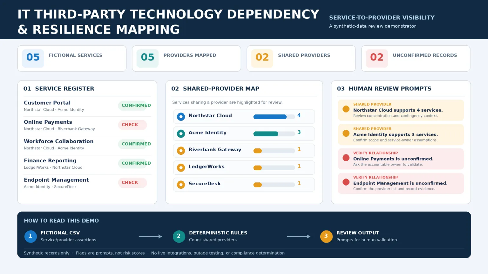

# IT Third-Party Technology Dependency & Resilience Mapping



A small, runnable proof of concept that maps fictional critical IT services to technology providers and dependencies. It flags shared-provider concentration and unconfirmed dependencies for human review.

> Deterministic Python rules with synthetic data only. This is not a vendor risk assessment, resilience test, compliance tool, or proof that recovery will work.

## What it demonstrates

- Read service-to-dependency relationships from a CSV.
- Build a transparent map of providers shared across services.
- Flag services with unconfirmed dependency records.
- Identify shared-provider concentration and single-provider exposure using explainable counts.
- Emit a CSV review report and JSON dependency map.

This complements the portfolio's #8 continuity-readiness checklist: #8 reviews recovery-record completeness; this project exposes shared technology dependencies across services. It complements #7 vendor performance by focusing on service-provider relationships, not supplier scorecards.

## Run

Requires Python 3.10+, no third-party packages.

```bash
python -m unittest discover -v
python -m dependency_poc.cli --input data/dependencies.csv --report reports/review.csv --map reports/map.json
```

## Sample data and output

The fixture contains fictional services, providers and dependency assertions. Rules count how many distinct services depend on each provider. Providers shared by two or more services receive a `SHARED_PROVIDER_REVIEW` flag. A service whose dependency verification is not `confirmed` receives `VERIFY_DEPENDENCIES`. This threshold is a demo rule, not a risk standard.

The map output groups service IDs by provider; the report output gives one row per service, its provider count, shared provider names, and review flags.

## Data dictionary

See [docs/DATA_DICTIONARY.md](docs/DATA_DICTIONARY.md). Review sequence and interpretation limits: [docs/OPERATING_MODEL.md](docs/OPERATING_MODEL.md).

## Limits and governance

The tool does not infer or discover dependencies, validate supplier declarations, inspect contracts, calculate criticality, assess substitutability, model outages, evaluate fourth parties, prescribe mitigations, or determine regulatory compliance. It has no vendor/API integrations and performs no live actions. Use no real or confidential data. A human owner must confirm every relationship and decide what action, if any, is appropriate.

## Repository layout

- `dependency_poc/`: parser, deterministic mapping rules and CLI
- `data/dependencies.csv`: fictional input fixture
- `tests/`: standard-library unit tests
- `docs/`: data dictionary, operating model and LinkedIn copy
- `docs/images/`: SVG design asset and WebP LinkedIn article banner

## References

- [Business Continuity Institute: Managing Critical Third-Party Technology Dependencies](https://www.thebci.org/resource/managing-critical-third-party-technology-dependencies.html)
- [Central Bank of Ireland: DORA](https://www.centralbank.ie/regulation/digital-operational-resilience-act-dora)

These sources establish professional context only. This project is not a DORA assessment.

## About

Shahid Al Parvez Malik is a Senior IT Infrastructure & Service Delivery Manager with 20+ years of professional IT experience across enterprise infrastructure, IT Operations, ITSM, service delivery, systems administration, networking, technical support, procurement and vendor management. [Portfolio](https://shahidalparvezmalik.com/) · [LinkedIn](https://www.linkedin.com/in/shahidalparvezmalik/)
